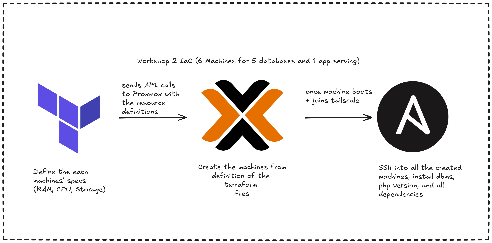

# Animal Shelter Workshop: Homelab Infrastructure (Terraform, Ansible, k3s)

This is a documentation-only archive of the infrastructure that ran the [Animal Shelter Workshop](https://github.com/tttaufiqqq/Animal-Shelter-Workshop) app: a Laravel system with five databases on three engines. It holds the Terraform, Ansible and Kubernetes code, and the write-ups of how each part was built, hardened and debugged.

> [!NOTE]
> **Status: archived.** The Proxmox homelab this code ran on has been taken down. Nothing here deploys to anything, and no workflow is scheduled. It is kept as a portfolio and learning record, and as the starting point for a rebuild on Azure ([Azure mapping](docs/azure-mapping.md)).

*The provisioning pipeline: Terraform describes the machines, Proxmox creates them, and Ansible configures them once they join the Tailscale mesh.*

The full topology, with a diagram, is in [Architecture](docs/architecture.md).

## Summary

- **What it is:** infrastructure as code for a self-hosted environment: 5 database hosts (PostgreSQL, MySQL, MariaDB), a k3s cluster running the app behind ArgoCD, Vault for secrets, and Prometheus, Grafana and Loki for monitoring.
- **The hard part:** every database sits on its own machine, reachable only over a Tailscale mesh, and every cross-database rule lives in the application. The infrastructure had to be rebuildable, auditable and safe to change without wiping data.
- **Verified:** the fleet was adopted into Terraform with `terraform import`, checked daily by a drift job, and the nightly backups were proven with a real restore drill. The write-ups in [`docs/`](docs/README.md) record the evidence and the mistakes.

## 1. Learning goals

- Provision VMs and containers on Proxmox with Terraform, including adopting existing machines instead of recreating them.
- Configure a fleet with Ansible roles that stay idempotent, and keep secrets in Vault rather than in files.
- Run an app on k3s with GitOps: a commit changes an image tag, ArgoCD syncs it.
- Harden hosts: private-only database ports, per-host firewalls, auto-start after reboot.
- Back up five databases consistently, and prove the backups restore.
- Monitor a mixed fleet and alert on real failures.

## 2. What this contains

| Path | What it is |
|---|---|
| `infrastructure/terraform/` | Proxmox VMs and containers, with state in a self-hosted MinIO bucket |
| `infrastructure/terraform-azure/` | A proof-then-destroy Azure VM, the first step toward the Azure rebuild |
| `infrastructure/ansible/` | Playbooks and roles for the database hosts, Vault, the CI runner and observability |
| `infrastructure/*.sh`, `*.py` | A disposable test-loop that creates and destroys scratch machines |
| `k8s/` | The app, nginx, Redis, a Cloudflare Tunnel, and monitoring agents for k3s |
| `docs/` | Architecture, rebuild order, implementation log, troubleshooting, and the original reference write-ups |
| `docs/examples/` | A daily Terraform drift-check workflow, kept as an example only |

### Limitations

- **Single homelab node.** One Proxmox host ran everything, so this was not a high-availability design.
- **No cloud.** Apart from the Azure stretch config and an Azure Blob backup target, nothing ran in a cloud.
- **Sandbox only.** The app's payment gateway was never switched to live, and there were no real users.
- **Secrets were never in this repo.** Terraform variable files and state are gitignored; Vault held the values.

### Cost

- **Cloud bill:** none. It ran on existing homelab hardware.
- **Cost that did matter:** RAM. The database VMs had no balloon device, so declared memory stayed pinned. Converting them to containers was the biggest single saving ([Implementation log](docs/implementation-log.md#3-timeline)).
- **Azure:** the stretch config's VM size had to change because the cheap burstable sizes were capacity-restricted. See [Troubleshooting](docs/troubleshooting.md#5-azure-sku-not-available).

## 3. Prerequisites

To read this, you need nothing. To adapt it, you would need:

- A Proxmox node and an API token
- [Terraform](https://developer.hashicorp.com/terraform/install) >= 1.5 and Ansible
- A Tailscale account, and a Vault server if you want the secrets flow

## 4. Rebuild order

The order the environment was stood up in, with a pointer to the detail for each step.

1. Provision the machines with Terraform. See [Terraform](docs/07-terraform.md).
2. Configure them with Ansible. See [Ansible](docs/06-ansible.md).
3. Harden the hosts. See [Hardening](docs/02-hardening.md).
4. Move secrets into Vault, then add the nightly backups. See [Production hardening](docs/09-production-hardening.md) and [Backups](docs/10-backups.md).
5. Apply the `k8s/` manifests and point ArgoCD at them. See [Rebuild](docs/deploy.md).

> [!WARNING]
> The commands and addresses refer to infrastructure that no longer exists. Treat them as a record, not as a runnable guide.

## 5. Results

What was verified, and where to read the evidence.

| Result | Where |
|---|---|
| 5 databases, each on its own host, reachable only over Tailscale | [Architecture](docs/architecture.md#2-topology), [Hardening](docs/02-hardening.md) |
| Whole fleet adopted into Terraform with `terraform import`, then watched by a daily drift check | [Terraform](docs/07-terraform.md), [Implementation log](docs/implementation-log.md#3-timeline) |
| Coordinated backups of all five databases, with a completed restore drill | [Backups](docs/10-backups.md) |
| Secrets moved from `.env` files to Vault, then to a Vault Agent that never writes them to disk | [Production hardening](docs/09-production-hardening.md) |
| Deploy by commit: image tag bump, ArgoCD sync, three replicas | [Architecture](docs/architecture.md#4-delivery-pipeline) |
| Alerts tested by deliberately breaking an nginx config and watching them fire | [Implementation log](docs/implementation-log.md#3-timeline) |

## 6. Differences from a textbook setup

| Typical approach | This project | Reason |
|---|---|---|
| Create new machines with Terraform | `terraform import` of existing machines | The machines were already running real data |
| One database server, several schemas | Five hosts, one per connection | The workshop's design goal was a distributed database |
| Public ingress to the app | A Cloudflare Tunnel from inside the cluster | No inbound port needed on the home network |
| Secrets in `.env` or Kubernetes Secrets | Vault, with Agent injection | Secrets stop touching disk |
| Managed cloud databases | Self-hosted containers | Cost, and to learn the operations side |

## 7. What I learned

- **Imported resources lie by default.** Provider defaults for `started`, `on_boot` and the disk controller silently differ from a real host, so a first `plan` shows changes that would reboot or reconfigure healthy machines.
- **Match state, not assumption.** A host that was deliberately powered off must be imported with `started = false`, or the first apply boots it.
- **Memory is the scarce resource.** Choosing containers over VMs freed more host RAM than any tuning.
- **Firewalls and overlays interact.** Tailscale's netfilter rules can bypass UFW, so the rule has to be tested, not assumed.
- **A pipeline can be a single point of confusion.** Keeping app code and infrastructure in one repo coupled their history, which is why this repo was split out.

Full timeline and every problem met: [Implementation log](docs/implementation-log.md). Symptom-to-fix reference: [Troubleshooting](docs/troubleshooting.md).

## 8. Related resources

- [Animal Shelter Workshop](https://github.com/tttaufiqqq/Animal-Shelter-Workshop): the application this infrastructure served
- [Homelab repo](https://github.com/tttaufiqqq/oracle-db-linux-proxmox): the wider homelab write-ups (Vault, MinIO, DevOps practice, monitoring)
- [Docs index](docs/README.md): the reading order for everything in `docs/`
