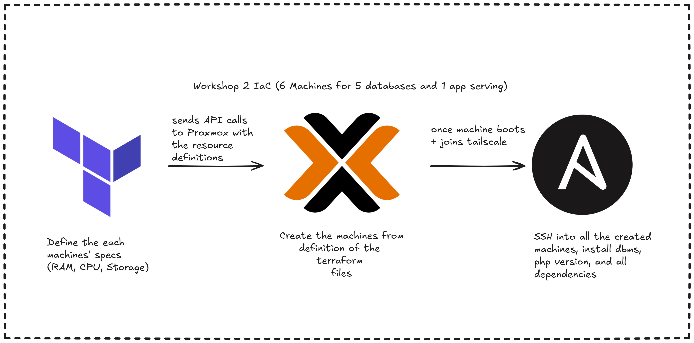

# Terraform

This article explains how Proxmox VMs and containers were provisioned with Terraform, what each set of resources is for, and the problems met along the way.

## 1. Scope

The configuration covers two groups of resources, both for the Animal Shelter Workshop only.

- **Test loop** (`vms.tf`): disposable machines created fresh with the `bpg/proxmox` provider. Each is cloned from an Ubuntu 24.04 cloud-init template and joins Tailscale on first boot.
- **Real fleet** (`production-vms.tf`, `containers.tf`): the machines the app actually needs, adopted with `terraform import` and never created fresh.

Shared homelab machines (`linux-mini-io`, `linux-k3s`, `linux-mongodb`, `linux-observability`) were imported here at first. None are specific to this app, so they moved to the homelab repository's own Terraform. `opnsense` and the stopped legacy VMs stay outside Terraform.


*The pipeline: Terraform describes the machines, Proxmox creates them, Ansible configures them.*

### 1.1 Test loop

| ID | Name | Role | Type |
|---|---|---|---|
| 201 | `test-app-server` | Laravel app | VM |
| 204 | `test-mysql` | MySQL 8.0 | VM |
| 205 | `test-mariadb` | MariaDB | VM |
| 206 | `test-postgres` | PostgreSQL | VM |
| 207 | `test-mysql-2` | Proves Terraform can create a CT | CT |
| 208 | `test-mariadb-2` | Same purpose | CT |

- IDs start at 201 because 101 to 107 are pre-existing VMs kept as backups.
- The two CTs are small (512 MB, 1 core), because they only prove creation works.
- A fresh CT needs a manual step before Tailscale works: the TUN device workaround, then installing and joining Tailscale with `pct exec`. CTs have no cloud-init equivalent.
- The `test-` prefix keeps `terraform state list` unambiguous next to the real resources.
- These resources are torn down after each proof.

### 1.2 Real fleet

| ID | Name | Role | Type |
|---|---|---|---|
| 101 | `app-server` | Laravel app | VM |
| 104 | `linux-mysql` | `shelter`, MySQL 8.0 | VM |
| 105 | `linux-mariadb` | `reporting`, MariaDB | VM |
| 106 | `linux-postgres` | `users`, PostgreSQL | VM |
| 112 | `linux-mysql-2` | `animals`, MySQL 8.0 | CT |
| 113 | `linux-mariadb-2` | `booking`, MariaDB | CT |
| 110 | `linux-vault` | Secrets | CT |
| 111 | `linux-gh-runner` | CI/CD | CT |

On 2026-08-02 the VMs 104, 105 and 106 became CTs, and the old VMs were kept powered off ([Implementation log](implementation-log.md#3-timeline)).

## 2. One-time prerequisites

### 2.1 Proxmox API token

In the Proxmox UI go to **Datacenter**, **Permissions**, **API Tokens**, **Add**. Use user `root@pam`, a token name such as `ansible`, and uncheck **Privilege Separation**.

```
proxmox_api_token = "root@pam!ansible=<uuid>"
```

### 2.2 Cloud-init template (VM 9000)

Run on the Proxmox host.

```bash
wget https://cloud-images.ubuntu.com/noble/current/noble-server-cloudimg-amd64.img \
  -O /tmp/ubuntu-24.04-cloud.img
qm create 9000 --name ubuntu-2404-template --memory 2048 --cores 2 \
  --net0 virtio,bridge=vmbr0 --ostype l26
qm importdisk 9000 /tmp/ubuntu-24.04-cloud.img local    # 'local', not 'local-lvm'
qm set 9000 --scsihw virtio-scsi-pci --scsi0 local:9000/vm-9000-disk-0.raw
qm set 9000 --ide2 local:cloudinit
qm set 9000 --boot c --bootdisk scsi0
qm set 9000 --serial0 socket --vga serial0
qm template 9000
```

### 2.3 Enable snippets

In the UI go to **Datacenter**, **Storage**, **local**, **Edit**, **Content**, and check **Snippets**. Terraform uploads cloud-init files as snippets, and `apply` fails without this.

### 2.4 Tailscale auth key

In the Tailscale admin go to **Settings**, **Keys**, **Generate auth key**. Set **Reusable** on, **Ephemeral** off and expiry to 90 days. Paste the `tskey-auth-...` value into `terraform.tfvars`.

### 2.5 State backend credentials

State lives in self-hosted MinIO on `linux-mini-io`, not a local file (`backend "s3"` in `main.tf`). It needs a bucket-scoped user, not the MinIO root account.

```bash
mc mb local/animal-shelter-workshop-tfstate
mc admin user add local terraform-asw '<generate-a-secret>'
mc admin policy create local terraform-asw-tfstate /path/to/policy.json
mc admin policy attach local terraform-asw-tfstate --user terraform-asw
```

The backend block holds no credentials. Export them before `init`, `plan` or `apply`.

```bash
export AWS_ACCESS_KEY_ID=terraform-asw
export AWS_SECRET_ACCESS_KEY=<secret from mc admin user add>
```

`linux-mini-io` (VM 109) is not always running. Run `qm status 109`, then `qm start 109` if it is stopped, or every command fails to reach the backend.

## 3. Configure

Install Terraform on the WSL control node. The HashiCorp apt repository did not support Ubuntu 25.04, so use snap.

```bash
sudo snap install terraform --classic
terraform version
```

Copy the example variables and fill them in.

```bash
cd infrastructure/terraform
cp terraform.tfvars.example terraform.tfvars
```

```hcl
proxmox_endpoint     = "https://<proxmox tailscale ip>:8006"
proxmox_api_token    = "root@pam!ansible=<uuid>"
proxmox_ssh_user     = "root"
proxmox_ssh_password = "<proxmox root password>"
proxmox_node         = "taufiq"        # node name from the Proxmox sidebar

vm_template_id = 9000
storage_pool   = "local"

ssh_public_key     = "<contents of ~/.ssh/id_ed25519.pub>"
tailscale_auth_key = "tskey-auth-..."
```

- `proxmox_node` is the name in the Proxmox sidebar (`taufiq`, not `pve`).
- `storage_pool` is `local` (Directory type), because LVM-thin does not exist here.
- `ssh_public_key` must match the private key Ansible uses.

## 4. Run

```bash
cd infrastructure/terraform
terraform init       # downloads bpg/proxmox v0.111.0
terraform plan       # read every line before applying
terraform apply
```

`apply` uploads four cloud-init snippets, clones VM 9000 four times (full clones), resizes each disk to 20 GB, attaches cloud-init with DHCP networking, and boots the VMs. Cloud-init creates a `workshop` user and joins Tailscale.

Afterwards, confirm the machines appear with `tailscale status`, wait about 60 seconds, and test SSH. The `workshop` user fails on the real hosts. Use the user in `~/.ssh/config`, then run `ansible-playbook playbooks/site.yml` ([Ansible](06-ansible.md)).

## 5. Drift check

A daily job (03:00 UTC, plus manual dispatch) ran `terraform plan` on `linux-gh-runner` and posted the result to the job summary. It never ran `apply`, because creating or destroying machines unattended is too destructive. The workflow is kept at [`examples/terraform-drift.yml`](examples/terraform-drift.yml).

| Part | Purpose |
|---|---|
| `TF_VAULT_TOKEN` | A separate Vault token in the runner's `.env`, limited to the `asw-terraform-cd` policy and the `secret/asw-terraform-cd` path |
| `vault-tf-token-renew.timer` | Renews that token daily |
| `TF_VAR_*` variables | Pass every value to Terraform, so no `terraform.tfvars` is ever written on the runner |

The path holds the Proxmox root credentials and the MinIO keys. It is kept apart from `secret/asw-cd` so a compromised app-deploy step cannot read hypervisor credentials.

`terraform plan -detailed-exitcode` returns 0 for no drift, 1 for an error and 2 for changes. Only 1 fails the job. Exit code 2 is reported in the summary, because the point is to surface drift, not block on it.

## 6. Lessons learned

Eight problems came up, from storage names to importing live machines. They are listed with their fixes in [Terraform lessons](terraform-lessons.md).
