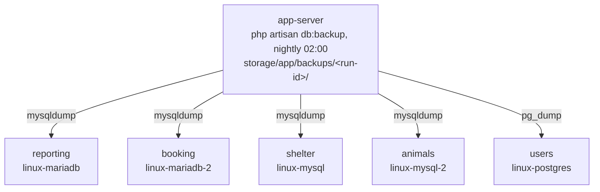
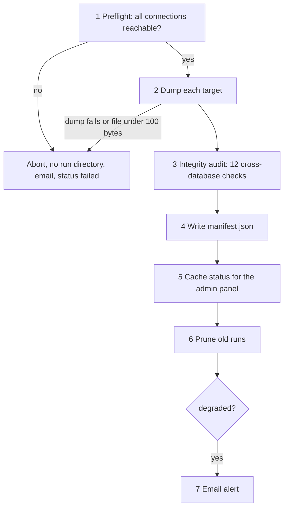

# Backups

This article explains how the five databases are backed up as one coordinated, verified set, how long backups are kept, and how to restore and drill them.

## 1. Why the design changed

The first design was a nightly `mysqldump` or `pg_dump` timer on each database host. It had five problems.

| Problem | Effect |
|---|---|
| Dumps stayed on the host they backed up | Losing a database VM lost its backups |
| The Windows host with `shelter` and `animals` was never backed up | Ansible's Linux playbooks cannot manage it |
| Three independent timers | A restored set could hold a `booking.userID` that is missing from that night's `users` dump |
| Silent failure | A non-zero exit into a systemd unit nobody watched |
| No retention floor | `find -mtime +7 -delete` could prune down to zero after seven failed nights |

The old scripts and units (`backup-{mysql,postgres}.sh.j2`, `db-backup.{service,timer}.j2` and their playbook tasks) were deleted. One command now does everything: `php artisan db:backup` on the app server.

## 2. Architecture

The app server dumps every database remotely. That gives one coordinated snapshot window, and backups land on a machine other than any database host.



*One run produces five dumps and a `manifest.json`.*

`BackupTargetResolver` groups connections by driver, host, port and database, so each physical database is dumped once. Every connection has its own host now, so the mapping is one to one.

| File prefix | Host | Engine | Connection |
|---|---|---|---|
| `mariadb-reporting-workshop2` | `linux-mariadb` | MariaDB | `reporting` |
| `mariadb-booking-workshop2` | `linux-mariadb-2` | MariaDB | `booking` |
| `mysql-shelter-workshop2` | `linux-mysql` | MySQL | `shelter` |
| `mysql-animals-workshop2` | `linux-mysql-2` | MySQL | `animals` |
| `pgsql-workshop2` | `linux-postgres` | PostgreSQL | `users` |

## 3. Nightly flow



The dump commands are `mysqldump --single-transaction --routines --triggers --events | gzip` and `pg_dump --format=custom --clean --if-exists`. The audit runs the 12 checks from [`04-foreign-keys`](https://github.com/tttaufiqqq/Animal-Shelter-Workshop/blob/main/docs/04-foreign-keys.md).

### 3.1 Abort instead of writing what you can

If one connection is down at the start, the command creates no run directory. A partial set is not a coordinated backup, and a half-written run that looks normal is more dangerous than none, because someone could restore from it without knowing it is incomplete.

### 3.2 Degraded is not failed

An orphan, such as a `booking.animalID` pointing at a deleted animal, does not make the dump bad. The files are complete, checksummed backups of what the databases hold. The run is marked `degraded`, flagged by email and a red panel, and still counts as successful for retention.

### 3.3 Credentials stay out of process lists

`mysqldump -p<password>` is visible to other users through `ps aux`. `MysqlCredentialsFile` writes a `chmod 0600` temporary `--defaults-extra-file` and deletes it right after. PostgreSQL tools take the password from `PGPASSWORD`, which `ps` does not show.

## 4. Retention

`BackupRetention` keeps the last **7 daily** runs plus the last **4 weekly** runs (the newest of each ISO week). It reads the `manifest.json` status, not file age.

- A `failed` run is never counted as a survivor.
- No pruning happens while 3 or fewer successful runs exist, so a bad week cannot shrink the set to zero.

## 5. Restore

```bash
php artisan db:restore <run> [--into-scratch] [--force]
```

1. Read `storage/app/backups/<run>/manifest.json`. Fail if it is missing.
2. Recompute the sha256 of every dump and compare it with the manifest. Refuse a corrupted dump.
3. Ask for confirmation, unless `--force`.
4. With `--into-scratch`, reset the `*_restore_test` databases and never the live ones. Otherwise restore into the live `workshop_2_prod` databases.
5. Run `mysql` or `pg_restore --clean --if-exists` per target.
6. Re-run the integrity audit. With `--into-scratch` it audits the scratch copies.
7. Print the orphan counts to compare with the manifest.

### 5.1 One-time scratch database setup

The scratch name is the live name plus `_restore_test`, so it is **`workshop_2_prod_restore_test`**. The app's regular user cannot create databases, so provision it once on each of the five servers.

```bash
# MySQL and MariaDB hosts, as root
mysql -u root -p -e "
  CREATE DATABASE IF NOT EXISTS workshop_2_prod_restore_test CHARACTER SET utf8mb4 COLLATE utf8mb4_unicode_ci;
  GRANT ALL PRIVILEGES ON workshop_2_prod_restore_test.* TO 'workshop_2_prod'@'%';
  FLUSH PRIVILEGES;"

# PostgreSQL, as postgres
psql -U postgres -c "CREATE DATABASE workshop_2_prod_restore_test;"
psql -U postgres -c "GRANT ALL PRIVILEGES ON DATABASE workshop_2_prod_restore_test TO workshop_2_prod;"
psql -U postgres -d workshop_2_prod_restore_test -c "GRANT ALL PRIVILEGES ON SCHEMA public TO workshop_2_prod;"
```

Two more grants were found only by running a real drill after the credential rename.

| Need | MySQL 8 hosts | MariaDB hosts |
|---|---|---|
| Dump routines whose `DEFINER` is another user | `GRANT SHOW_ROUTINE ON *.* TO 'workshop_2_prod'@'%';` | `GRANT SELECT ON mysql.proc TO 'workshop_2_prod'@'%';` |
| Restore routines, triggers and views with another `DEFINER` | `GRANT SET_USER_ID ON *.* TO 'workshop_2_prod'@'%';` | `GRANT SUPER ON *.* TO 'workshop_2_prod'@'%';` |

The second grant is a consequence of renaming the connecting credential without recreating every routine. It was accepted because there is no real data. In a real system, backup and restore would use their own privileged credential.

On PostgreSQL, a database created from a copy keeps each table's original owner, and a database-level grant does not cascade to existing tables.

```sql
\c workshop_2_prod_restore_test
REASSIGN OWNED BY <old_role> TO workshop_2_prod;
```

### 5.2 The restore drill

An untested backup is not a backup. Run the drill periodically, and after any change to the dump or restore code.

```bash
php artisan db:restore 20260720_020000 --into-scratch --force
```

Confirm the orphan counts match the run's manifest. If the drill shows more orphans than the manifest, the restore introduced a problem.

| Date | Run | Result |
|---|---|---|
| 2026-07-20 | `20260720_080021`, all five servers after the rename | Pass after fixes, with 0 orphans |
| 2026-07-19 | `20260719_180705`, the three-host topology of that day | Pass |

**2026-07-20.** The first `db:backup` failed with `insufficient privileges to SHOW CREATE PROCEDURE`, which led to the routine grants. `db:restore` then failed twice: three of the five scratch databases had never been provisioned, and the `SUPER` and `SET_USER_ID` grant was missing. With both fixed, all five engines restored and the audit found 0 orphans.

**2026-07-19.** `gunzip -t` and `pg_restore --list` confirmed valid archives (163 TOC entries), and the MariaDB dump held 39 procedures. The audit found 0 orphans, and restored row counts matched the live ones: `users` 9/9, `animal` 102/102, `booking` 601/601.

## 6. Alerting

- **Admin panel:** `/admin/backups` shows the latest status (`ok`, `degraded`, `failed`) and a history table, from `Cache::get('backup_last_status')` and every `manifest.json`.
- **Email:** `DatabaseBackupFailed` is sent on `failed` or `degraded` runs to `config('mail.backup_alert_to')` (`BACKUP_ALERT_EMAIL`).

**Open item:** with `MAIL_MAILER=log`, mail is written to `storage/logs/laravel.log`, not delivered. Set `BACKUP_ALERT_EMAIL` and a real mailer, as for password reset ([Production hardening](09-production-hardening.md)). Until then the admin panel is the only working alert.

## 7. `manifest.json`

```json
{
    "run_id": "20260720_020000",
    "status": "ok",
    "started_at": "2026-07-20T02:00:00+00:00",
    "finished_at": "2026-07-20T02:03:41+00:00",
    "duration_seconds": 221.4,
    "targets": {
        "mariadb-reporting-workshop2": { "file": "mariadb-reporting-workshop2.sql.gz", "bytes": 184320, "sha256": "..." },
        "pgsql-workshop2": { "file": "pgsql-workshop2.dump", "bytes": 40192, "sha256": "..." }
    },
    "orphans": {
        "reporting.report.userID -> users.users.id": 0,
        "booking.adoption.animalID -> animals.animal.id": 0
    }
}
```

## 8. Where things live

| Piece | Path |
|---|---|
| Backup and restore commands | `app/Console/Commands/BackupDatabases.php`, `RestoreDatabases.php` |
| Target grouping, dump, restore | `app/Services/Backup/BackupTargetResolver.php`, `DatabaseDumper.php`, `DatabaseRestorer.php` |
| Manifest, audit, retention | `BackupManifest.php`, `LogicalForeignKeyAudit.php`, `BackupRetention.php` |
| Credential file handling | `MysqlCredentialsFile.php` |
| Alert email | `app/Mail/DatabaseBackupFailed.php`, `resources/views/emails/backup-alert.blade.php` |
| Admin panel | `app/Http/Controllers/Admin/BackupController.php` |
| Schedule | `routes/console.php` |
| Backup storage | `storage/app/backups/<run-id>/` on the app server |
| Ansible | `infrastructure/ansible/playbooks/app-server.yml` (client tools and storage directory) |

The application files are in the [Animal Shelter Workshop](https://github.com/tttaufiqqq/Animal-Shelter-Workshop) repository.
