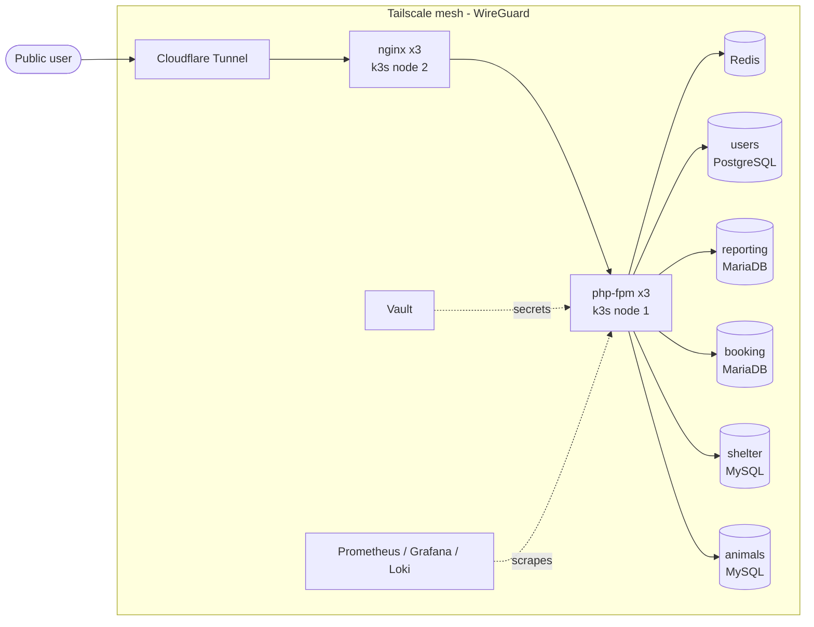
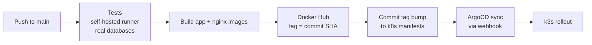

# Architecture

This article explains the machines, network and pipeline this repository describes, and why each part exists. The environment is gone; this is the design as it last ran.

## 1. The problem it solves

The application has five modules, and each owns its own database on its own engine. No database can enforce a foreign key into another, so the infrastructure had to give every connection a separate, private, rebuildable home, and keep the whole thing cheap enough to run on one homelab node.

Three constraints shaped everything else:

- **One database per physical machine.** No shared hosts, so a problem on one cannot touch another.
- **No public database ports.** Every database is reachable only over a private mesh network.
- **Everything is code.** Any machine can be recreated from Terraform and Ansible, and the app is deployed by a commit.

## 2. Topology

*Request path and private mesh. Each database host's firewall accepts traffic only from the app tier's mesh address.*

| Machine | Role | Engine / software |
|---|---|---|
| `linux-postgres` | `users` connection | PostgreSQL |
| `linux-mariadb` | `reporting` connection | MariaDB |
| `linux-mariadb-2` | `booking` connection (stored procedures, triggers) | MariaDB |
| `linux-mysql` | `shelter` connection | MySQL 8.0 |
| `linux-mysql-2` | `animals` connection | MySQL 8.0 |
| `linux-k3s`, `-2`, `-3` | Kubernetes nodes for the app, nginx and the tunnel | k3s |
| `linux-vault` | Secrets store | Vault |
| `linux-observability` | Metrics, logs and alerts | Prometheus, Grafana, Loki, Alertmanager |
| `linux-gh-runner` | Self-hosted CI runner | GitHub Actions runner |
| `app-server` | The original single app host, later retired | nginx, php-fpm |

The five database hosts started as VMs, then became Proxmox containers (CT) because VMs here had no balloon device and kept their declared memory pinned. The old VMs were kept powered off as a rollback net. See [Implementation log](implementation-log.md#3-timeline).

## 3. Why each design decision was made

| Decision | Choice | Reason |
|---|---|---|
| Network | Tailscale mesh, no database port on the public internet | One rule per host: accept the app tier only |
| Machine type | Containers for the databases | RAM; a VM without a balloon device holds its full allocation |
| State | Terraform state in self-hosted MinIO | Shared and recoverable, with no cloud account |
| Adoption | `terraform import` for running machines | They held real data; recreating them was not an option |
| Secrets | Vault, with Agent injection | Passwords stop living in `.env` files and cached config |
| Databases per host | One prod database and one dev database | Local development never touches production data |
| Ingress | Cloudflare Tunnel from inside the cluster | No inbound port needed on the home network |
| Sessions | Redis inside the cluster | Three stateless replicas need shared sessions and cache |

## 4. Delivery pipeline

*A commit becomes a rollout. Images are tagged by commit SHA, never `latest`, because ArgoCD needs a real diff in git to sync.*

- **Tests ran against real copies of all five databases** on a runner inside the mesh, because the databases are unreachable from GitHub's hosted runners.
- **The tag bump was a commit.** It carried `[skip ci]` so the bump never re-triggered the tests.
- **Rolling updates used `maxSurge: 0`.** One k3s node had a single CPU, so a surge pod could never schedule.
- **Repository split.** The bump originally committed into the app repository. A cross-repo version, where the app repository notifies this one, was written but the homelab was taken down before it went live.

## 5. Monitoring

Prometheus scrapes node metrics from every host and Kubernetes object state from the cluster. Promtail and Grafana Alloy ship logs to Loki. Alertmanager sends to Telegram.

Alert rules cover: instance down, disk space (warning and critical tiers), pod crash looping, pods stuck waiting, ArgoCD out of sync, and database connectivity probes. The rules are in `infrastructure/ansible/files/prometheus-alert-rules.yml`.

The alerts were validated by deliberately breaking an nginx config on the live cluster, watching them fire, and reverting it ([Implementation log](implementation-log.md#3-timeline)).

## 6. What was left out

- **No high availability.** One Proxmox node, one resolver path, one Vault.
- **No redundancy for the databases.** Backups, not replicas, were the recovery plan ([Backups](10-backups.md)).
- **No cross-database transactions.** Each module commits to its own database; consistency is the application's job.
